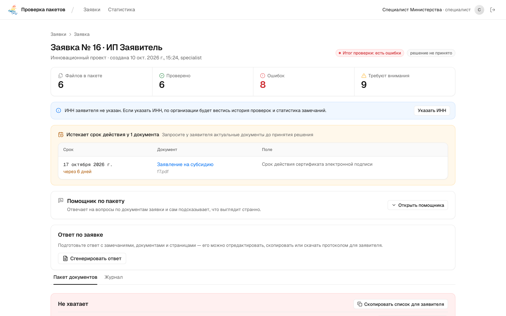
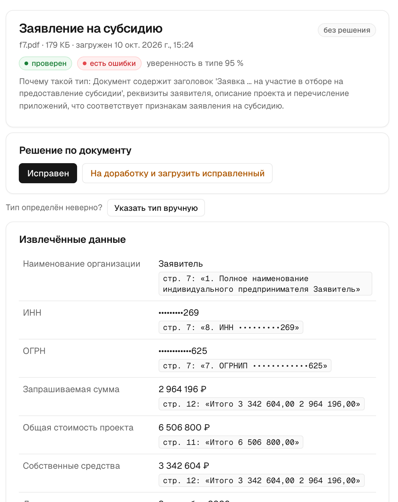
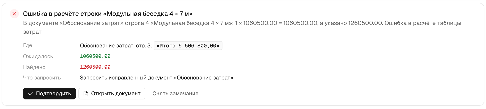
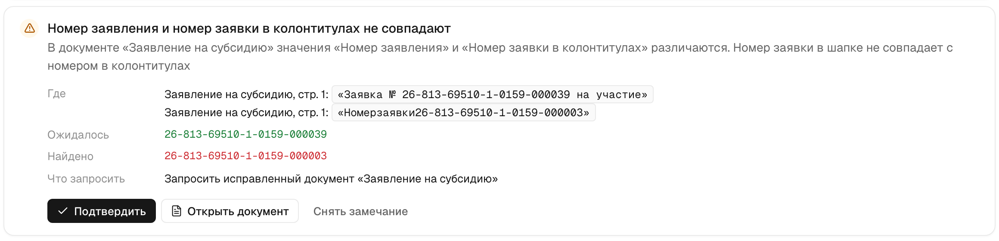
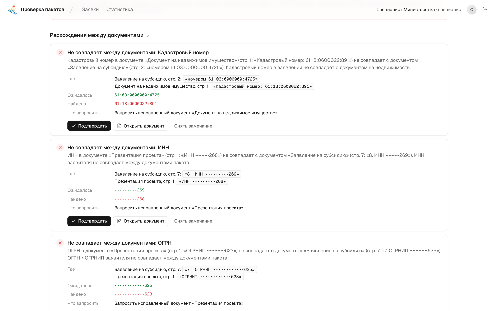
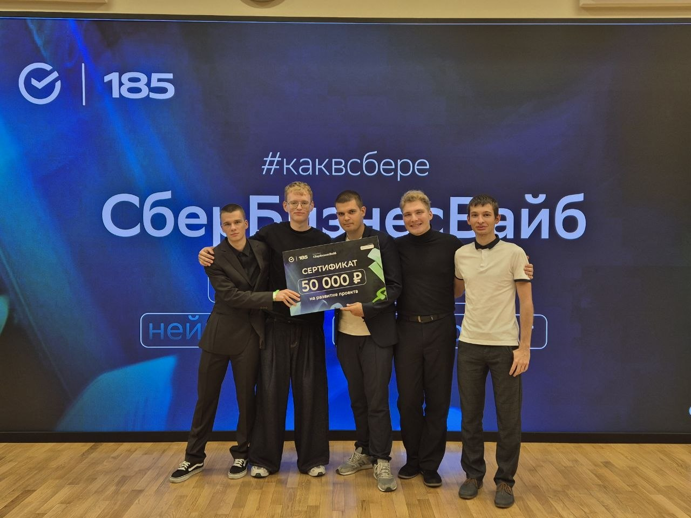
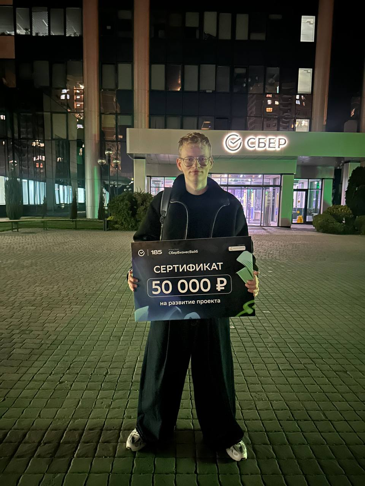

На этих выходных поучаствовали в новом для себя формате - вайботоне СберБизнесВайб. Это хакатон, где главное - вайбкодинг: решение нужно не писать руками, а именно вайбкодить, и сделать его очень быстро. На все было около 7 часов.

Я считаю, что это очень удачный формат в новых реалиях. Для меня было очень интересно, как с этим справится наша команда и справятся ли ИИ-агенты.

Самое непонятное было в организации. Как сделать, чтобы все пятеро были при деле, а фичи, которые каждый делает со своими агентами по отдельности, можно было "поженить" за час до презентации? В итоге в самом начале разбили систему на пять частей и сразу договорились, как они общаются между собой. Дальше каждый работал в своей ветке, а под конец все собрали вместе. И мы справились.

## Кейс

Кейс был от Сбера и Министерства экономического развития Ростовской области.

Министерство выдает организациям субсидии. Чтобы получить субсидию, организация подает пакет документов: заявление, согласие на обработку персональных данных, обоснование затрат, выписку из банка, гарантийное письмо и другие. Специалист проверяет его вручную: открывает каждый файл, понимает, что это за документ, сверяет с перечнем, проверяет сроки, ИНН и суммы, считает доли на калькуляторе. На один пакет уходит от 20 минут, а ошибки всплывают уже на согласовании.

Задача - сделать инструмент, который сам разбирает пакет и отдает специалисту готовый результат проверки. Важное условие: тип документа нужно определять по содержимому, а не по имени файла. А решение по заявке все равно принимает человек.

## Что получилось

Решение получилось действительно крутым, полезным и, самое главное, на 90% рабочим.

Специалист загружает файлы и через минуту видит итог по пакету: что пройдено, что требует внимания, где ошибки и каких документов не хватает.

Под капотом пять шагов:

1. Достаем из файла текст, сканы и фото распознаем.
2. Языковая модель определяет вид документа. Имя файла не используется, а если модель не уверена, документ уходит специалисту.
3. Из документа достаем ИНН, суммы, даты, номера. Каждое значение сохраняется вместе со страницей и точной цитатой. Если цитаты в тексте нет, значение не принимается, поэтому модель не может ничего "придумать".
4. Проверяем комплектность по программе субсидии и правила: сроки, даты, ИНН, долю собственных средств, совпадение сумм.
5. Сверяем документы между собой.

## Что нашла система

Больше всего порадовало, что система находила расхождения, которые мы сами при подготовке к кейсу не нашли. Несколько примеров с открытого набора организаторов:

- **Номер заявки.** В шапке заявления один номер (…000025), а в колонтитулах - другой (…000003).
- **Расчеты.** В смете строка "Модульная беседка": 1 × 1 060 500 = 1 060 500, а в таблице указано 1 260 500. Сумма строк не сходится с итогом.
- **Электронная подпись.** В строке "Подписано" 03.09.2026 16:22, а в самом штампе подписи - 05.09.2026 16:00. А один и тот же сертификат подписи встречается у двух разных заявителей.
- **Реквизиты.** ИНН и ОГРНИП в заявлении и презентации отличаются на одну цифру, а кадастровый номер участка в заявлении из другого района, чем в выписке из реестра.
- **Деньги.** Остаток на счете меньше собственных средств, которые заявитель обещает вложить.

Для каждого расхождения видно, где что написано, что ожидалось и какой документ запросить у заявителя.

## Основные фичи

- Тип документа по содержимому, с объяснением, почему выбран именно он.
- Каждое найденное значение подтверждено цитатой и страницей, клик открывает оригинал.
- Сканы и фото распознаются.
- Проверка комплектности по программе, в том числе документов, которые нужны не всегда.
- Проверки правил и сверка документов между собой.
- Предупреждение об истекающих сроках документов и сертификатов подписи.
- Помощник, который отвечает на вопросы по пакету.
- Ответ заявителю со списком замечаний, который можно скачать протоколом.
- Статистика частых ошибок и история проверок по организации.
- Администратор меняет правила, пороги и перечни документов без программиста.
- Можно работать на локальной модели, чтобы документы с персональными данными не уходили наружу.

Стек: Java 21 и Spring Boot, React, PostgreSQL, Keycloak. Модели: Qwen и olmOCR в облаке, Qwen в Ollama и Tesseract локально.

## Итог

Мы победили и получили сертификат на 50 000 ₽ на развитие проекта.

